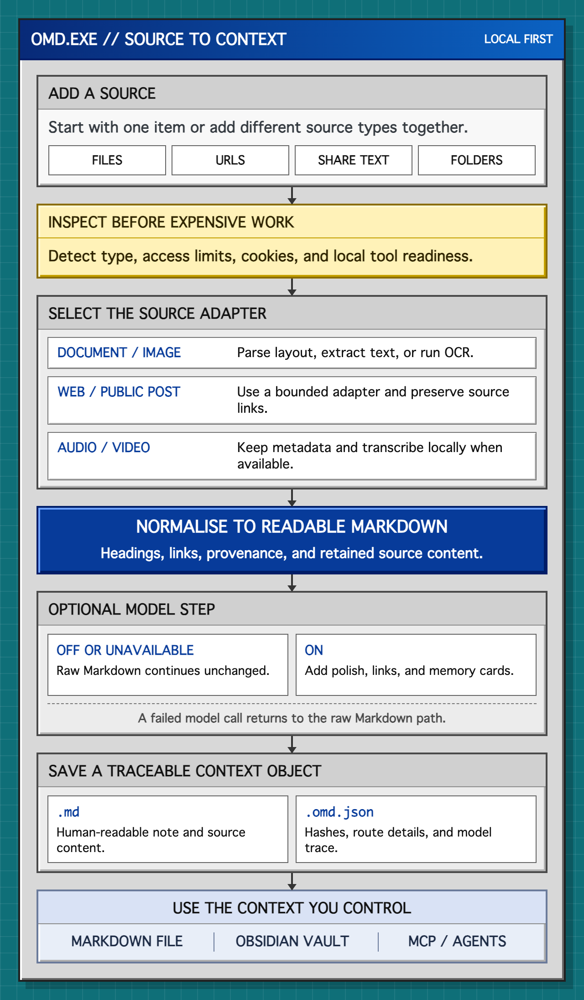

<div align="center">

<sub>OMD.EXE // PUBLIC BETA 0.3.0b4</sub>

# OMD.EXE

**A local AI context inbox for Markdown, Obsidian, and agents.**

Turn documents, web pages, screenshots, audio, folders, and selected public
URLs into traceable Markdown that stays in folders you control.

[](https://github.com/omd-local/markdown-everything/actions/workflows/ci.yml)
[](https://www.python.org/downloads/)
[](LICENSE)
[](docs/privacy.md)

[Install](#quick-start) ·
[Documentation](#documentation) ·
[Report an issue](https://github.com/omd-local/markdown-everything/issues)

</div>

**Beta 0.3.0b4 provides the core backend for OMD Home, the command line, and
MCP.** The browser UI is deferred until its Gradio/Pillow dependencies have a
compatible, audited installation. OMD Home does not require that browser UI.

## How conversion stays recoverable

<p align="center">
  <a href="docs/assets/omd-context-pipeline.png">
    <picture>
      <source media="(max-width: 600px)" srcset="docs/assets/omd-context-pipeline-mobile.png">
      
    </picture>
  </a>
</p>

Core conversion never depends on AI. Optional model work is isolated, so a
missing model or failed call leaves the raw Markdown intact.

## Quick start

```bash
brew install omd-local/omd/omd
omd doctor
omd capabilities --json
```

For an existing Homebrew installation:

```bash
brew update
brew upgrade omd-local/omd/omd
```

In **OMD Home** settings, use the absolute executable path printed by:

```bash
echo "$(brew --prefix omd-local/omd/omd)/bin/omd"
```

Run `omd capabilities --json` with that executable to confirm `package_version`
is `0.3.0b4` and `protocol_version` is `1`, then refresh Home's backend check.
Home still needs a separate client update for disclosure readiness preflight
and the explicit **"Nothing was sent"** error. Updating this backend does not
change Home's error display.

The command line can also convert directly or capture into an Obsidian folder:

```bash
omd report.pdf -o report.md
omd capture report.pdf --vault ~/Obsidian/AI-Memory
```

The custom Homebrew tap includes the project organisation in the command.
`omd-local` is the project owner, not a personal account. The beta installs the
CLI, MCP server, common document converters, and `yt-dlp`. The `omd-ui` command
explains that the browser UI is unavailable in this release; it does not start
a server. Large transcription and local-model tools remain optional.

<details>
<summary><strong>SETUP MENU // manual install and optional local tools</strong></summary>

### Manual install

```bash
git clone https://github.com/omd-local/markdown-everything.git omd
cd omd
pip install -e .
pip install 'markitdown[docx,outlook,pdf,pptx,xls,xlsx]>=0.1.6,<0.2' 'pillow>=13.0.0,<14' yt-dlp
omd doctor
```

The dependency-free core supports Python 3.10 or newer. The optional document
converters require Python 3.11 or newer for Pillow 13; Homebrew uses Python 3.12.
A minimal `pip install -e .` registers `omd`
and `omd-mcp` without Python runtime dependencies. Document converters and media
tools are optional. The `all` extra includes conversion tools, not the deferred
browser UI; there is no supported `ui` extra in this release.

### Optional local model

OMD never downloads Ollama models automatically. Install and start Ollama, then
run the model install command in Terminal. OMD recommends a conservative
instruct model from the machine's total memory; this is a 16 GB example:

```bash
ollama pull qwen3:4b-instruct
```

Keep the Ollama host at `http://localhost:11434` for fully local model calls. Core
conversion still works when Ollama is absent or stopped.

### Hosted AI readiness

Hosted AI is optional and requires explicit consent for each request. The
backend validates provider disclosures before credentials, model checks, or
provider requests. OpenAI and Anthropic disclosures were reviewed on
2026-11-02; DeepSeek remains unavailable because the reviewed official sources
do not establish an applicable API retention policy for OMD evidence.

`omd capabilities --json` reports current disclosure readiness without reading
Vault evidence. A missing, expired, or unverified disclosure fails closed with
`disclosure_unavailable`. Disclosure readiness alone does not authorize a request
or guarantee model availability. Capture, conversion, and local AI do not depend
on Hosted AI readiness.

### Optional transcription and OCR

```bash
# Apple Silicon speech-to-text for audio, podcasts, and supported videos
brew install pipx
pipx install mlx-whisper

# Text recognition inside screenshots and article images
brew install tesseract tesseract-lang
```

**OCR** means optical character recognition: it reads visible text from an image.
English uses `eng`; mixed Chinese and English can use `chi_sim+eng`. `mlx-whisper`
is Apple-Silicon only and is intentionally excluded from the base install because
its model stack is large.

</details>

<details>
<summary><strong>SOURCE MENU // formats, public URLs, and cookie-gated routes</strong></summary>

- **Documents:** PDF, DOCX, PPTX, XLSX, HTML, CSV, JSON, XML, EPUB, and ZIP
  use MarkItDown.
- **Images:** PNG, JPG, WEBP, TIFF, and BMP use Tesseract OCR.
- **Audio:** MP3, WAV, M4A, FLAC, and OGG use local Whisper when installed.
- **Web:** articles, WeChat, and public webpages use a source adapter or web
  conversion.
- **Public posts:** Reddit, X, Bluesky, Mastodon, Threads, Hacker News, and
  Telegram use bounded public adapters.
- **Media:** Apple Podcasts, YouTube, TikTok, and Bilibili preserve metadata and
  use local transcription when available.
- **Local batches:** folders and saved one-item-per-line lists route each item
  independently.

OMD does not bypass paywalls, login gates, captchas, access controls, or platform
restrictions. Public posts can be deleted, private, quarantined, region-blocked,
or rate-limited; a URL that opens in your signed-in browser may still reject an
anonymous converter.

### Douyin and Xiaohongshu / Rednote

These advanced local-only routes normally need separate Netscape `cookies.txt`
exports. Export cookies only from an account and content you are authorised to
use, then pass the matching file with `--cookies`:

- **Douyin cookies:** export while signed in to `douyin.com`.
- **Xiaohongshu cookies:** export while signed in to `xiaohongshu.com`.
- Do not reuse one platform's cookie file for the other platform.
- Never commit cookie files.

Use `omd inspect "<url>" --with-readiness --cookies /path/to/cookies.txt` before
starting to check local source and cookie readiness.

</details>

<details>
<summary><strong>OUTPUT MENU // Markdown, Obsidian, polish, and memory cards</strong></summary>

### Direct Markdown

```bash
omd report.pdf -o report.md
omd screenshot.png -o screenshot.md --lang eng
omd bilingual.png -o bilingual.md --lang chi_sim+eng
```

### Obsidian-compatible vault capture

```bash
omd capture report.pdf --vault ~/Obsidian/AI-Memory --tags research,pdf
omd capture "https://example.com/article" --vault ~/Obsidian/AI-Memory
```

Capture writes a readable note under `Sources/<source type>/`, updates
`Index/OMD Captures.md`, and keeps hashes, route diagnostics, model errors, and
other debug metadata in the adjacent `.omd.json` sidecar.

### Optional local AI sections

```bash
omd report.pdf -o report.md --polish-md --polish-md-keep-raw
omd capture report.pdf --vault ~/Obsidian/AI-Memory --memory-cards
```

`--polish-md` cleans parser/OCR noise. `--memory-cards` adds a summary, useful
tags, `[[links]]`, and evidence-oriented cards above the preserved
`## Full Content`. Review all generated content before relying on it.

Read the [Obsidian guide](docs/obsidian.md) and
[memory cards guide](docs/memory-cards-user-guide.md). The optional provider
boundary is documented in the [privacy model](docs/privacy.md).

</details>

<details>
<summary><strong>TOOLS MENU // CLI recipes, MCP, and agent-safe mode</strong></summary>

```bash
# Inspect routing, tools, cookies, and local readiness without converting
omd inspect "<url-or-file>" --with-readiness

# Convert a folder or reusable one-item-per-line list
omd batch sources.txt -o out/
omd capture ~/Downloads/sources/ --vault ~/Obsidian/AI-Memory --batch

# Quiet deterministic output for agent-facing runs
omd --agent-safe report.pdf -o report.md

# Read-only vault-aware note enrichment proposal
omd enrich-note Inbox/example.md --vault ~/Obsidian/AI-Memory --json-events
omd enrich-note --request-json - --json-events < request.json
omd capabilities --json
```

`enrich-note` returns a validated proposal on stdout and never edits the vault.
The complete v1 stdin/response/event contract is documented in the
[enrich-note contract](docs/enrich-note-contract-v1.md). Obsidian plugin authors
should also follow the [plugin integration guide](docs/obsidian-plugin-integration.md)
for capability negotiation, subprocess isolation, response validation, and the
hash-checked Vault API write boundary.

`omd-mcp` exposes four tools:

- `convert_to_markdown(uri, output?, output_format?, lang?, reel_options?)`
- `inspect_source(uri, include_readiness?, cookies?, cookies_from_browser?)`
- `capture_to_vault(uri, vault, lang?, tags?)`
- `list_supported_formats()`

Minimal MCP configuration:

```json
{
  "mcpServers": {
    "omd": {
      "command": "omd-mcp"
    }
  }
}
```

Treat converted Markdown as untrusted input. MCP restricts local paths and
private-network URLs by default; use narrow `OMD_MCP_ALLOWED_ROOTS` only for
folders you intend the client to access.

</details>

<details>
<summary><strong>HELP MENU // common failures and what survives</strong></summary>

| Symptom | What to check |
|---|---|
| `markitdown` missing | Reinstall the Homebrew package or install the common document converters shown above. |
| `omd-ui` reports unavailable | Beta 0.3.0b4 ships the core backend. Use OMD Home or the CLI while the browser UI is deferred. |
| OCR language unavailable | Install `tesseract-lang`; use `eng` or `chi_sim+eng`. |
| Local model warning | Start Ollama and run the displayed `ollama pull <model>` command. Raw Markdown is retained. |
| Web or Reddit HTTP 403 | The source rejected automated access. Save an authorised copy as HTML or PDF and convert the local file. |
| Douyin / Xiaohongshu warning | Export a fresh platform-specific cookie file and pass it with `--cookies`. |
| Partial failure in a multi-file run | Open the output folder; successful items and partial raw outputs are retained when safe. |

Run `omd doctor` for local capability checks. For a reproducible report, include
a non-sensitive sample, the warning text, and `--verbose` output. Verbose logs
are shown in the process log and are not added to the user-facing Markdown note.

</details>

<details>
<summary><strong>PROJECT MENU // development, acknowledgements, and licence</strong></summary>

```bash
git clone https://github.com/omd-local/markdown-everything.git omd
cd omd
pip install -e '.[all,test,audit]'
make smoke
make test
```

OMD builds on
[Microsoft MarkItDown](https://github.com/microsoft/markitdown),
[yt-dlp](https://github.com/yt-dlp/yt-dlp),
[f2](https://github.com/Johnserf-Seed/f2),
[MLX Whisper](https://github.com/ml-explore/mlx-examples/tree/main/whisper),
[Ollama](https://ollama.com/), and
[Tesseract](https://github.com/tesseract-ocr/tesseract).

Issues and focused pull requests are welcome. Read
[SECURITY.md](SECURITY.md) before reporting a vulnerability. OMD is released
under the [MIT License](LICENSE).

</details>

## Local-first, with explicit boundaries

> **Personal note use only.** OMD is designed for personal research,
> note-taking, and AI-assisted knowledge workflows. It is not a legal,
> compliance, evidentiary, or archival system. Output may omit, reorder, or
> reformat source content. You are responsible for ensuring you have the right
> to access, process, and store each source. OMD does not bypass paywalls,
> access controls, or platform restrictions. Review AI-generated summaries,
> tags, Evidence, and `[[links]]` before relying on them.

Local-first does not mean every URL workflow is offline: URLs contact their
source platform, and explicitly configured remote model endpoints receive the
content sent to them. Keep private material in local workflows with loopback
Ollama. See the [privacy model](docs/privacy.md) and
[security policy](SECURITY.md).

## Documentation

| Read this | When you need it |
|---|---|
| [Examples](examples/README.md) | Copy-ready conversion, capture, inspect, batch, and polish commands |
| [Obsidian vault capture](docs/obsidian.md) | Folder layout, sidecars, indexes, and repeated captures |
| [Memory cards guide](docs/memory-cards-user-guide.md) | Local model setup and generated note sections |
| [Privacy model](docs/privacy.md) | What stays local and when network access is used |
| [Changelog](CHANGELOG.md) | Release history and current beta changes |

<div align="center">

**LOCAL SOURCES -> TRACEABLE MARKDOWN -> CONTEXT YOU CONTROL**

[Star this repository](https://github.com/omd-local/markdown-everything) ·
[Report a bug](https://github.com/omd-local/markdown-everything/issues) ·
[MIT License](LICENSE)

</div>
